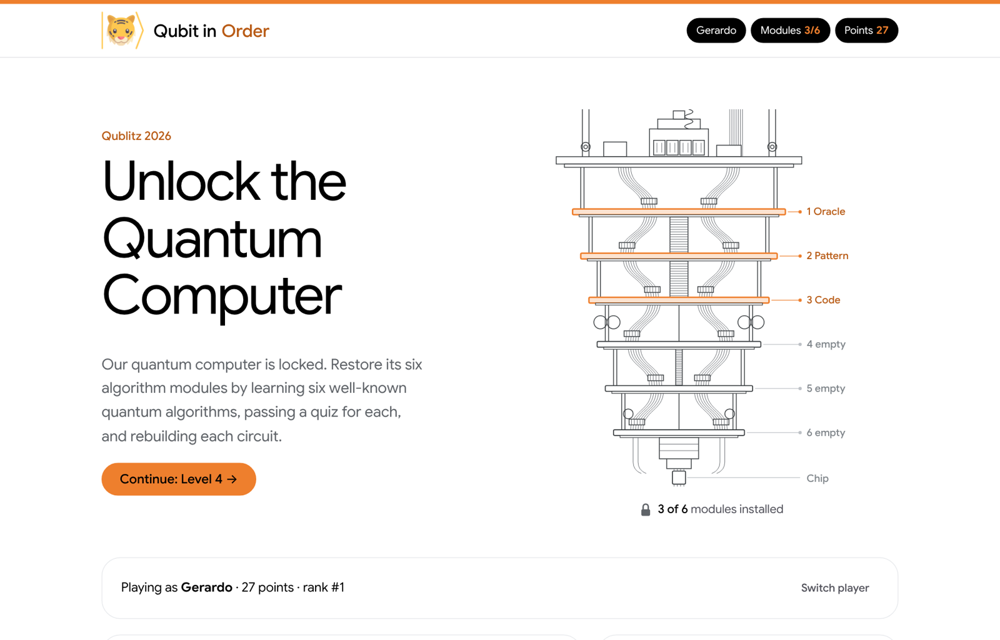
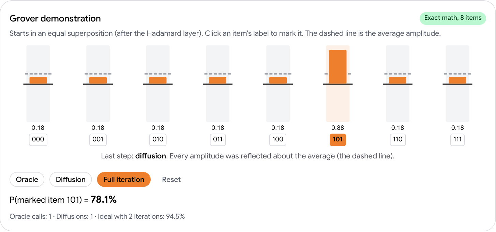
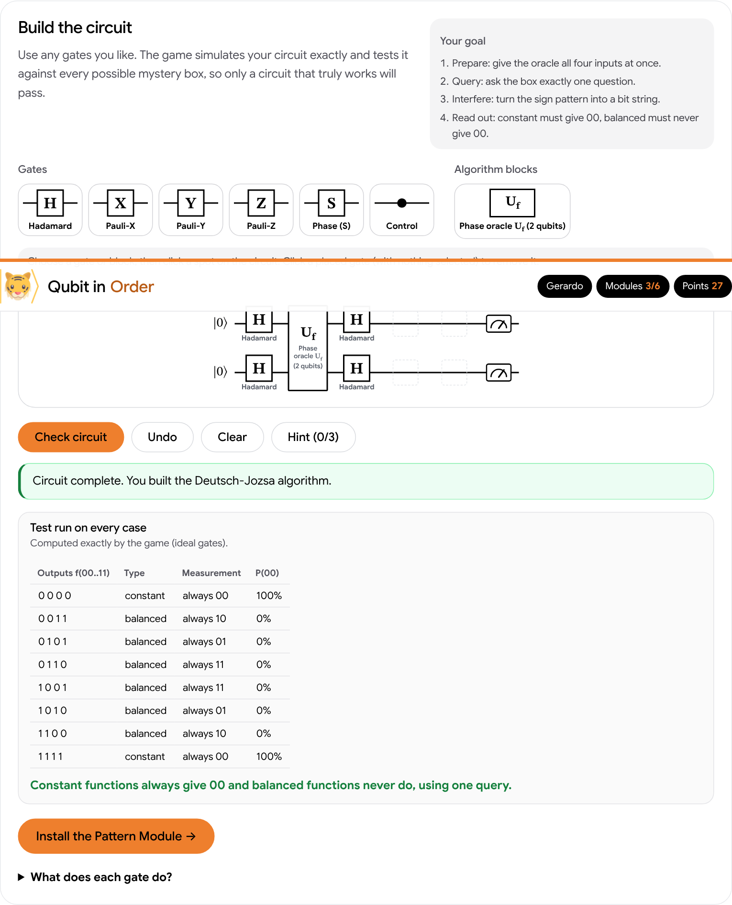

# Qubit in Order: Unlock the Quantum Computer

**Play it:** https://g-caravez.github.io/Qublitz-2026-Submission/qubit-in-order/

A browser game that teaches six well-known quantum algorithms, from Deutsch to Shor. A quantum computer is locked; each algorithm you learn, test and rebuild installs one of its six modules. Install all six and it powers on.

Made for **Qublitz 2026 · Quantum Create**, hosted by Princeton Students in Quantum.
Created by **Gerardo Caravez ’29** and **Cristian Hernandez ’29**, Princeton University.



## Why we made it

Quantum algorithms are usually taught as matrices and proofs, so the key idea (amplitudes that interfere, adding up on right answers and cancelling on wrong ones) stays abstract. We wanted a beginner to *see* that happen, change it with their own hands, and then prove they understand it by building the real circuit. Every number on screen comes from an exact calculation, so the game never shows a picture that is "roughly" right.

## The quantum computing in it

| Level | Algorithm | Quantum idea the player works with | What the player builds |
|---|---|---|---|
| 1 | Deutsch | superposition, phase oracles, interference | H, U_f, H on one qubit |
| 2 | Deutsch-Jozsa | one query to all inputs at once; the all-zeros amplitude is the average of the signs | Hadamards, oracle, Hadamards on 2 qubits |
| 3 | Bernstein-Vazirani | parity functions s·x; the final Hadamards turn the sign pattern into the secret | Hadamards, oracle, Hadamards on 3 qubits |
| 4 | Simon | XOR-hidden pairs; every measured y satisfies y·s = 0; classical linear algebra finishes the job | the circuit, then collect samples and solve for s |
| 5 | Grover | amplitude amplification: oracle plus diffusion (reflection about the average), and overshooting | the right number of iterations for 8 items |
| 6 | Shor | RSA, period finding, the quantum Fourier transform, continued fractions | factoring 15 with a = 2, then turning the period into factors |

Each level has four steps:

1. **Learn:** 5 to 6 short lesson cards, including a worked "step by step" example with exact amplitudes and an Applications card (real-world impact, with sources). Shor's level opens with RSA and has a full section on the quantum Fourier transform.
2. **Explore:** an interactive demonstration with 3 challenges, answered by changing the demonstration.
3. **Quiz:** pick Easy, Medium or Hard; 10 questions; 8 correct unlocks Build. The bank has 360 original questions (20 per difficulty per level). After a failed quiz the retry uses 10 different questions, or the same 10 reshuffled (a setting on the home screen).
4. **Build:** place real gates (Hadamard, Pauli-X/Y/Z, Phase S and a Control dot) plus the level's prebuilt blocks on a circuit grid, then press **Check circuit**.

Levels can be played in any order. Points: +1 per correct Easy answer, +2 Medium, +3 Hard; only the best quiz per level counts (maximum 180). A leaderboard shows the top 5 players on the device.



## Run it

- **Online:** open the link at the top. Nothing to install.
- **On your own computer:** download this repository (green **Code** button → **Download ZIP**), unzip it and double-click `index.html`. It works offline in any modern browser (Chrome, Safari, Firefox, Edge).

There is no build step, no server and no external code. It is plain HTML, CSS and JavaScript.

## How it works

### Exact simulation

`js/logic.js` holds a small **state-vector simulator** with complex amplitudes. Qubit 0 is the top wire. It applies H, X, Y, Z and S, with any number of controls (a Control dot makes every gate in its time step controlled, so Control + Pauli-X is a CNOT). The circuit builder simulates exactly the circuit the player built, up to 8 qubits, with ideal (noise-free) gates.

Four larger operations are **prebuilt blocks**, each computed exactly as a whole: the oracles, Grover diffusion, modular exponentiation (2^x mod 15) and the quantum Fourier transform. The game says this on each block and in the footer: it is a demonstrative game, not a simulation of real quantum hardware.

### Checking a circuit

**Check circuit** does not compare the player's gates with an answer key. It runs the circuit against **every possible mystery box** for that level and checks what the circuit actually does:

| Level | Tested against | Passes when |
|---|---|---|
| Deutsch | all 4 one-bit functions | constant always gives 0, balanced always 1, with one query |
| Deutsch-Jozsa | 2 constant + all 6 balanced 2-bit functions | constant always gives 00, balanced never does, with one query |
| Bernstein-Vazirani | all 8 secrets | the result equals s with certainty, with one query |
| Simon | all 7 masks | every measured y has y·s = 0, and all four such y appear equally often |
| Grover | all 8 marked items | success is at least 90% for every marked item |
| Shor (N = 15, a = 2) | | the counting register shows only 0, 4, 8, 12 (25% each) |

So any correct circuit passes, including correct variants the lessons never showed (for example X, H, U_f, H, X in Level 1), and a wrong one gets a specific reason and a table of what it really did.



### The demonstrations

| Level | Demonstration | What it shows |
|---|---|---|
| 1 | Qubit | signed amplitudes and probabilities as H, U_f, H are switched on and off, for all four mystery boxes |
| 2 | Truth table | flip any output; constant, balanced or neither, with the exact P(00) |
| 3 | Parity | s·x mod 2 step by step, the sign pattern, and cracking a mystery code with classical queries |
| 4 | XOR pairs | which inputs share outputs, their XOR, and which y can be measured |
| 5 | Grover | amplitude bars, the average line, oracle and diffusion steps, and overshooting |
| 6 | Fourier clocks | each surviving input as a clock hand; the hands add as arrows to give the exact QFT probabilities for periods 2, 3, 4 and 8 |

The clock demonstration is our own interactive version of the clock analogy in Aaronson's Lecture 20.

## How we verified it

- **Automatic tests:** open [`tests.html`](tests.html) in a browser. It runs **80 checks**, and every one should be green:
  - every question is well formed (4 distinct options, a valid answer, an explanation, 20 per difficulty, interactive questions included);
  - quiz drawing over thousands of random draws: no repeats, fair answer positions, a retry with new questions never repeats one, a reshuffled retry keeps the same questions;
  - the 8/10 pass mark, points and leaderboard order;
  - the simulator against known results (for example Hadamard then CNOT gives a Bell state, controlled-Z is symmetric, and the QFT followed by its inverse is the identity);
  - each level's circuit checker on correct circuits, correct variants and wrong circuits;
  - every Explore challenge.
- **Exhaustive checking:** for Level 1 we ran all 16,807 possible circuits (7 choices in each of 5 slots) through the game's checker and compared every verdict with an independent NumPy calculation. They agree on all of them: exactly 105 circuits are valid, and the checker accepts those and only those.
- **Question math:** numerical answers in the questions (Grover amplitudes, QFT outputs, clock probabilities, gcd and modular arithmetic) were computed with the game's own simulator.
- **Reproducible question bank:** `tools/convert_questions.py` regenerates `data/questions.js` byte for byte from the source files in `tools/` (see `tools/README.md`).
- **Playthrough:** all six levels played from start to finish, including on a phone-sized screen and with animations turned off.

## Limitations

- Ideal, noise-free circuits only, and small ones (up to 8 qubits). The prebuilt blocks are exact but their insides are not shown gate by gate.
- Shor's level factors only N = 15 with a = 2, so the circuit stays small enough to see.
- The leaderboard and progress are saved in each browser (localStorage), not shared between devices.
- The Suggestions form sends through FormSubmit, a free email-forwarding service, and only works when the game is online.

## Project structure

```
index.html          page shell; loads the files below in order
css/style.css       all styling
data/levels.js      the six levels: lessons, demonstrations, challenges, circuit puzzles, hints; the gate list
data/questions.js   360 quiz questions (generated, see tools/)
js/logic.js         rules and math: quiz drawing and grading, points, leaderboard, the simulator, circuit checkers
js/labs.js          the six interactive demonstrations
js/motion.js        smooth motion between screen updates
js/ui.js            display helpers (escaping, maths formatting, gate pictures)
js/app.js           screens, buttons, players, saved progress, settings
tests.html          the automatic tests
tools/              scripts and source files that generate data/questions.js
assets/             logos, site icon and fonts
docs/               screenshots for this README
```

Data lives in `.js` files instead of `.json` because browsers block loading `.json` from a page opened by double-clicking it.

## Sources and credits

- Scott Aaronson, *Introduction to Quantum Information Science* lecture notes: Lectures 17-23 (Deutsch, Deutsch-Jozsa, Bernstein-Vazirani, Simon, RSA and period finding, the QFT, continued fractions, Grover and its applications). Lessons and questions are original adaptations of these concepts, not copies.
- Applications cards also cite: C. Gidney (2025), *How to factor 2048 bit RSA integers with less than a million noisy qubits*; the RSA-250 factoring record (2020); NIST FIPS 203, 204 and 205 post-quantum standards (2024).
- Fonts: Google Sans and STIX Two, both under the SIL Open Font License (`assets/fonts/LICENSE-fonts.txt`).
- Logos: Princeton University and Princeton Students in Quantum, used for this Qublitz entry.
- AI tools were used during development, as permitted by the challenge rules.

## For developers

**Questions:** edit `tools/new_questions.py` or `tools/new_questions_b2.py` and regenerate (see `tools/README.md`), or edit `data/questions.js` directly. Each question needs a unique `id`, a `difficulty`, a `prompt`, exactly 4 `options`, `correctIndex`, an `explanation` and a `source`. Run `tests.html` afterwards.

**Lessons and puzzles:** `data/levels.js`. Lesson `html` is shown as written. Circuit puzzles are described by `rows`, `cols`, `gates`, `macros`, `goals` and 3 `hints`.

**Saved data:** browser localStorage key `quantum-quest-save-v3` (players, best quiz per level, modules, settings).

**Suggestions form:** settings are in `SUGGEST` in `js/app.js`. The first message sent from the live site triggers a one-time activation email from FormSubmit to the first address; after that, messages arrive at both addresses.

**Publishing:** this repository is published with GitHub Pages (Settings → Pages → Deploy from a branch → `main`, `/ (root)`). The empty `.nojekyll` file makes GitHub serve the files exactly as they are.
